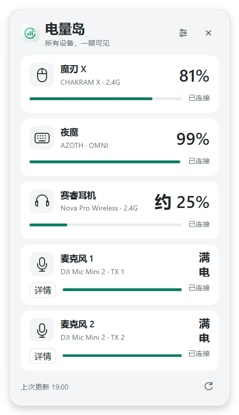
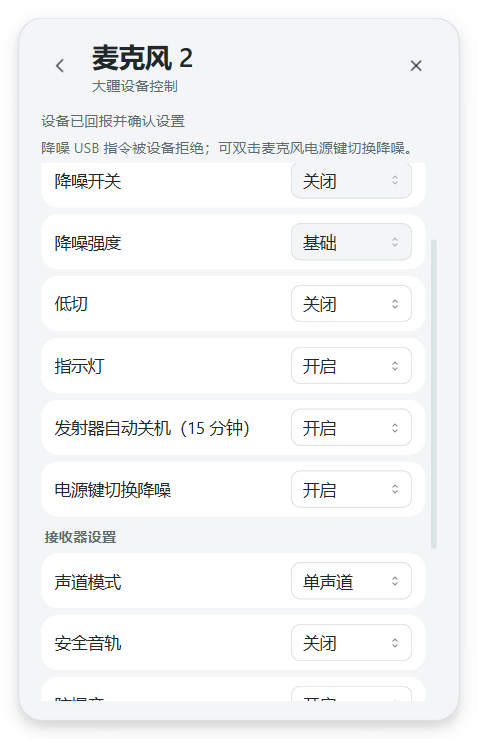

# DJI Mic Mini 2：DJI 分支

原生集成到 ChargeDock，不启动其他控制软件、不注入界面。原有鼠标、键盘、耳机、
单托盘窗口、四语和配置格式保留。**电量已真机验证，控制部分支持，限制见下文。**

## 接口与驱动

仅识别 **2CA3:4011 / MI_06**，校验接口号 6、Bulk IN `0x86`、OUT `0x06`。
SetupAPI 枚举当前设备，读取该功能的驱动注册信息，再用 Configuration Manager
解析动态接口 GUID；不固定 GUID、设备路径或序列号。不依赖 HID 枚举。

程序不会安装驱动、写驱动注册表或结束其他程序。其他电脑需要预先为
**`USB\VID_2CA3&PID_4011&MI_06`** 安装 WinUSB。
**不得操作 MI_01 音频、MI_00 HID 或整个复合设备。** 无法区分接口时应停止安装。
多个接收器同时存在暂不选择，明确报错，避免悄悄读取错误设备。

本机 DJI Mic Control 运行时，打开 MI_06 返回 WinError 5；用户手动退出后可以读取。
WinError 5 也可能是权限不足，提示不能单独证明具体哪个进程占用。

## 电量语义

v2 状态帧是 52 字节头、0–2 个 32 字节 TX 槽和 CRC16。
整帧 `+44` 连接位图 bit0/bit1 对应 TX1/TX2；槽 `+1` 是实际单元号。
槽 `+7` 的 `(byte >> 2) & 7` 是档位，`byte & 2` 是充电标志。
唯一在线的 TX2 始终是麦克风 2。

| 档位 | 显示 |
|---|---|
| 1 | 满电 |
| 2–4 | 电量充足 |
| 5 | 电量偏低 |
| 6 | 电量很低 |
| 7 | 即将耗尽 |
| 0 / 没有槽数据 | 电量未知 |

条形图仅示意类别，2–4 档长度相同；不线性换算百分比，不把未知当成 0%。
v1 使用独立槽结构，仅解析连接状态，电量明确显示不支持。耳机近似百分比保持不变。
麦克风不发送低电量提醒。

## 通信与恢复

- `dji_usb.py`：独立 WinUSB；IN/OUT 管道超时 200 ms，只打开 MI_06。
- `dji_protocol.py`：有界拆包、CRC8/CRC16、版本/编号/身份/状态解析。
  CRC8 反射寄存器初值 `0x77`（反射前常记为 `0xEE`）；v2 CRC16 初值
  `0x3692`，整帧余数 0，均已与本机实际推送核对。
- `dji_worker.py`：唯一连接所有者，电量与控制共用同一循环。
  会话目录的原子 JSON 邮箱避免 windowed EXE 没有标准输入输出的问题。
- `dji_client.py`：Qt 子进程监督、结果校验、局部合并；界面线程不操作 USB。
  父进程租约过期后子进程退出；崩溃重启不会重放上一次设置命令。
- 3 秒无有效状态标记上次读取，6 秒关闭重开；连接失败退避 5→10→20…300 秒。
  手动刷新跳过重连等待。子进程无心跳 6 秒则终止，5 秒后重建。
- 接收器不存在、驱动缺失、接口占用、发射器离线、无有效状态、读取失败、上次读取
  均有不同状态码。HID 子进程及其重试完全独立，不会阻止 DJI 工作进程。

## 控制与明确限制

卡片“详情”进入四语原生界面，区分接收器、TX 广播和单 TX 音色。
不乐观切换选项；对应序号的成功 ACK 加发送后的状态推送一致，才报告确认。
立体声与安全音轨额外核对互斥状态。普通命令 3 秒超时；重启命令 15 秒，并核对
重连后的接收器身份。非成功 ACK 明确失败，在本次连接中禁用该项。

**本机 Mic Mini 2 接收器不接受降噪开关及强度写入。**
按指定参考源码向 TX 广播发送 `0x0038`、`0x0037`，真机均返回非成功 ACK `0xFF`，
状态不变。另一份协议实现 `usokawa/dji-mic-mo` 也明确排除了产品名
`DJI Mic Mini 2` 接收器的这两项写入。因此识别到此接收器后显示为只读，
不声称完整控制支持。回报状态按 TX 槽 `+7 bit0`、`+6 bit5` 读取；
两只 TX 不一致时不会伪装成统一开关。

后续还测试了当前在线 TX2 的直接地址 `0x0002` 及接收器地址 `0x0000`，
同样的两条降噪指令均返回 `0xFF`，没有改变真实状态。与广播地址的结果一致。
这说明目前核对过的 USB 路径仍未找到有效写法，不代表已经证明所有固件/传输都不可实现。
没有混用其他型号的 BLE 指令或发送未知 USB 指令。
官方 [Mic Mini 2 用户手册](https://dl.djicdn.com/downloads/MIC_MINI_2/20260421/UM/MINI2_um_en2.pdf)
说明可以双击发射器电源键切换降噪，并可通过 DJI Mimo 调整参数。

## 设置页稳定性修复

- 后台每半秒的时间戳心跳继续监督，但相同设备状态不再触发 UI 更新。
- 相同托盘颜色不再重设图标，相同卡片内容不再重新绘制；设备推送不调整设置页窗口尺寸。
- DJI 选项不参与原本已禁用的 Tab 焦点导航。发送时禁用控件不再把焦点逐个转移到末行，
  因而不会触发 QScrollArea 自动滚到底部。原值回显、待确认和失败反馈保持不变。
- 自动测试先复现了滚动到 306 像素和重复设置托盘图标的问题，再验证修复。
  原生 Qt + 真机测试在顶部 0 和中段 120 像素进行设置、确认和恢复，滚动位置均不变；
  稳态观察中托盘图标重设和窗口重排次数均为 0。

免拔插外放有明确的重启、短暂中断音频提示，用户确认后才发送。
**本次未真机触发它。** v1 控制未实现；其他型号/固件未验证。

## 验证记录

2026-10-22 使用独立 `--data-dir`：

101 项自动化测试通过（含原 69 项回归）；源码界面和 Windows EXE 均完成实际读取及
TX2 音色往返确认。机器路径已从公开测试记录中移除，见 [验证记录](docs/dji-validation.json)。





| 功能 | 验证情况 |
|---|---|
| 两只 TX 电量 | 真机同时在线、实际编号 1/2、均档位 1、未充电 |
| 无 TX 在线 | 真机连接位图 0，明确显示离线 |
| DJI Mic Control 共存 | 无法共开，由用户手动退出其他软件 |
| 低切、单/立体声、安全音轨、防爆音、指示灯 | 真机更改、成功 ACK、状态回报、恢复 |
| RX/TX 自动关机、电源键降噪权限、相机电源联动 | 真机更改、确认、恢复 |
| TX1 / TX2 音色 | 分别真机更改、确认、恢复；另一只音色不变 |
| 降噪开关、强度 | 真机返回 `0xFF`，只读限制 |
| 免拔插外放 / 重启确认 | 仅协议及事务测试，未触发真机重启 |
| 各档位、充电、单独 TX2、CRC 错误、截断/粘包、重连、超时 | 自动化模拟测试 |
| v1 连接槽和未知电量 | 协议测试，无 v1 真机 |

所有实际设置修改前先记录原值，测试结束重新读取确认恢复。
没有覆盖现用 EXE、真实配置、启动项、奥创组件或任何驱动。

## 构建与隔离测试

```powershell
python -m unittest discover -s . -p 'test_*.py'
python -m PyInstaller --noconfirm ChargeDock.spec
.\dist\ChargeDock.exe --data-dir .\dji-test-data
```

`--poll-output` / `--poll-key` 仍是原 HID 子进程接口，`--once` 保留原三类设备输出。
DJI 使用受管理的内部 `--dji-worker`，不要同时手动启动另一个 DJI 读取进程。
协议来源和完整许可证见 [ATTRIBUTION.md](ATTRIBUTION.md)、[licenses/](licenses/)。
