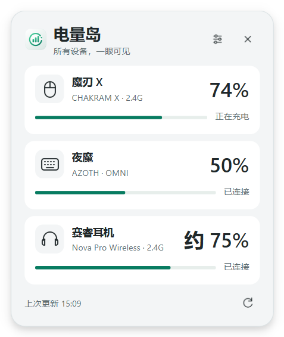

# 电量岛 · ChargeDock

一个安静的 Windows 外设电量工具。单个托盘图标，点击在右下角展开临时窗口。

基于 [yszyszysz233/2.4G-battery-viewer](https://github.com/yszyszysz233/2.4G-battery-viewer) 的 Windows HID 底层开发；ROG 和耳机电量协议分别参考 G-Helper 与 HeadsetControl。具体代码来源、参考版本和许可证说明见 [ATTRIBUTION.md](ATTRIBUTION.md) 与 [LICENSING.md](LICENSING.md)。



## 使用

双击 `ChargeDock.exe`，不需要安装 Python。再次运行只会打开已有窗口，不会再创建图标。

- 左键托盘图标：展开或收起电量窗口。
- 点击窗口外、按 Esc 或超过设定时间：自动收起；鼠标停在窗口内时不会自动关闭。
- 右键托盘图标：打开设置、立即刷新、暂停提醒 30 分钟或退出。
- 刷新间隔和收起时间使用整块菜单按钮，点击任意位置即可展开选择。
- 设置立即保存；浅色/深色外观跟随 Windows 应用主题。
- 内置简体中文、日语、英语、韩语，默认跟随系统；设置页可即时切换语言。
- 可选开机启动，默认关闭。启用后请保持 EXE 路径不变。

## 三台设备

| 设备 | 接口 | 显示 |
| --- | --- | --- |
| ROG 魔刃 X / CHAKRAM X | 0B05:1A1A（本机实测）/ 1A18 | 百分比、充电状态 |
| ROG 夜魔 / AZOTH | OMNI 0B05:1ACE（本机实测）/ 1A83 / 1A85 | 百分比、充电状态 |
| SteelSeries Arctis Nova Pro Wireless | 基站 1038:12E0（本机实测）/ 12E5 | 近似百分比、充电或离线状态 |

耳机通过基站查询，按设备上报的 0–8 档换算，显示“约 XX%”。本版本不支持蓝牙读取，未列出的型号不代表已支持。USB 和原装夜魔无线等未在本机连接的变体按公开协议实现，尚未真机验证。

## 唤醒后自动更新

- 鼠标、键盘闲置 20 秒后的首次活动，或已知离线设备的首次活动，会在约 0.65 秒后补读电量。
- 只根据设备活动通知判断，不读取、保存或分析按键内容。连续操作不会不断刷新；重复通知会合并，正在读取时会等待完成再补读。
- 设备重新连接、电脑从睡眠恢复时自动补读。打开窗口时，若距上次更新超过 10 秒，也会补读。
- 耳机支持基站活动通知；耳机离线但基站仍存在时，每 5 秒只补查耳机，读到电量后恢复正常刷新间隔。
- 这里根据设备活动判断可能的唤醒，不能直接获知所有固件内部的睡眠状态。

## 低电量提醒

- 只对鼠标和键盘提醒，耳机始终不提醒。
- 鼠标、键盘可以分别开启或关闭提醒，阈值各自可调 1–99%，默认 20%。
- 电量小于或等于阈值时显示一次 Windows 通知，不强行打开电量窗口。
- 同一次低电量状态不会在每轮刷新时重复提醒。开始充电，或电量恢复到阈值以上 5 个百分点后，才重新允许提醒。
- 充电中、未连接、无效电量和读取失败不会触发提醒。
- 提示音默认关闭，可在设置中开启；Windows 自身通知和勿扰设置仍由系统控制。
- 程序重启后，若设备仍处于低电量，会在首次成功读取后提醒一次。

## 奥创电量浮窗

设置中提供“关闭显示”和“打开显示”，操作时会弹出 Windows 管理员授权提示。

- 关闭：仅结束 `AcPowerNotification.exe`，并在原目录将其改名为 `AcPowerNotification.exe.disabled` 保留。
- 打开：恢复该文件，并启动原奥创通知程序。
- 不停止奥创主服务，不修改文件权限、不删除文件。
- “打开显示”不会修复奥创组件本身的未响应问题。
- 奥创升级可能恢复原程序。如果原程序和备份同时存在，本软件会停止更改并说明原因，保留两份文件。
- 固定目标目录：`C:\Program Files (x86)\ASUS\ArmouryDevice\dll\AcPowerNotification`。

## 稳定性与数据

界面进程不直接进行 HID 读写。读取在独立子进程中运行，超过 9 秒会结束本次读取并保留上次电量，标注“上次读取”，避免设备无响应拖住窗口。

只在本机读取设备，没有联网、遥测或上传。刷新间隔默认 60 秒，可调 30 秒、1 分钟、2 分钟、5 分钟。

设置保存在 `%LOCALAPPDATA%\ChargeDock\settings.json`。正常读取的中间文件在使用后清除。开机启动设置只在用户手动切换时更改。

## 源码与构建

想改设备名称、显示顺序、适配自己的设备或扩展提醒，请先阅读 [设备与提醒适配指南](ADAPTATION.md)。交给 AI 修改时，可直接使用指南内的提问模板。新增语言及界面文案见 [语言接口说明](LOCALIZATION.md)。当前尚未提供任意设备的图形化 DIY 添加功能。

Windows 64 位，Python 3.11：

```text
python -m venv .venv
.venv\Scripts\python -m pip install -r requirements.txt
.venv\Scripts\python -m unittest discover -p "test_*.py" -v
.venv\Scripts\python -m PyInstaller --noconfirm ChargeDock.spec
```

`assets/app.svg` 是可编辑的原创矢量图标，`app.png`、`app.ico` 是导出文件。界面符号也由 SVG 路径绘制。

## 来源

- Windows HID 底层：[yszyszysz233/2.4G-battery-viewer](https://github.com/yszyszysz233/2.4G-battery-viewer)。
- ROG 协议参考：[seerge/g-helper](https://github.com/seerge/g-helper)。
- 赛睿耳机协议参考：[Sapd/HeadsetControl](https://github.com/Sapd/HeadsetControl)。

完整引用和固定版本链接见 [ATTRIBUTION.md](ATTRIBUTION.md)。第三方运行库说明见 [THIRD_PARTY_NOTICES.txt](THIRD_PARTY_NOTICES.txt)，测试范围见 [VALIDATION.md](VALIDATION.md)。
